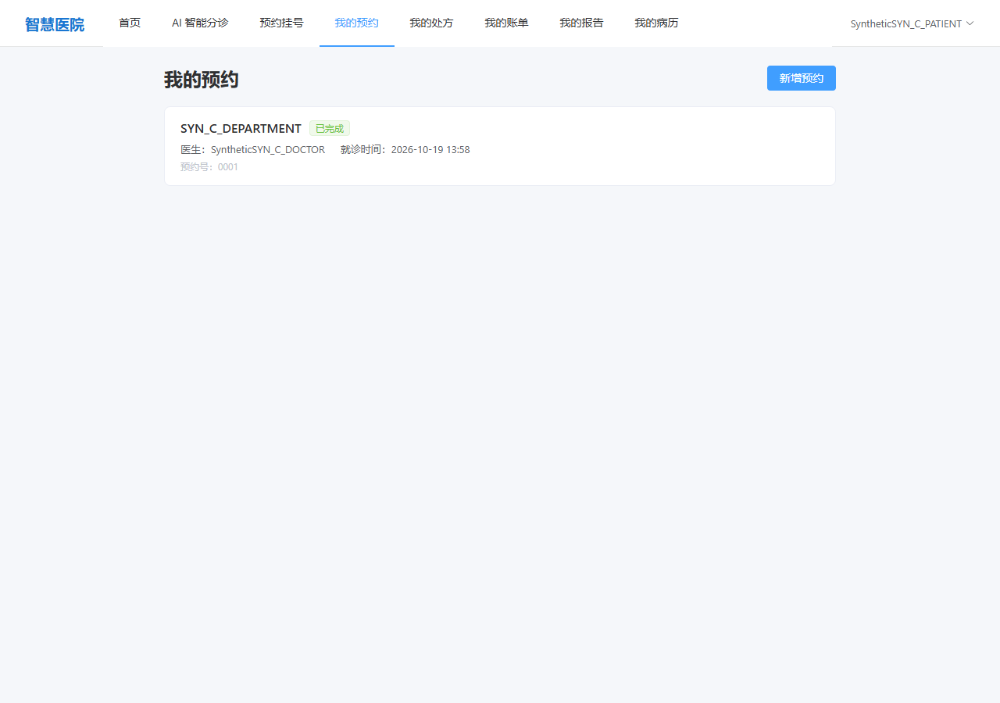
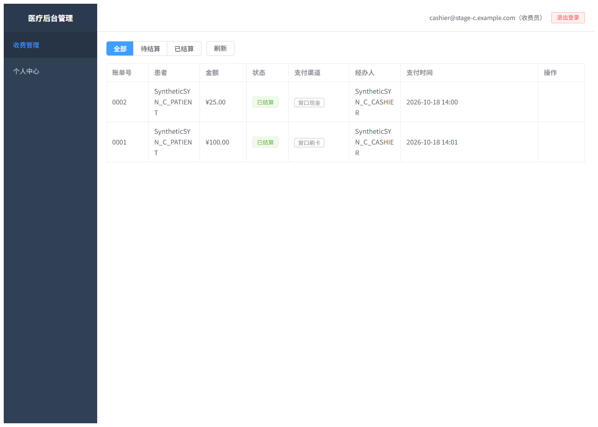

# 智能医疗预约诊疗系统

基于 **FastAPI + Vue 3 + PostgreSQL + Redis + Celery** 的前后端分离医疗业务演示系统，围绕患者预约、医生接诊、电子病历和费用账单等流程构建，并集成基于 **DeepSeek、自定义工作流编排与 RAG** 的 AI 辅助能力。

> 本项目使用虚构演示数据，用于开发学习、技术交流与求职展示；不接入真实患者或医保系统。AI 内容仅作辅助参考，不能替代专业医疗诊断，不可直接用于医疗机构生产环境。

## 系统架构

```text
患者端 medical-client (Vue 3 + TypeScript + Vite)
                  │
                  ├────── HTTP API ──────┐
                  │                      │
管理后台 medical-admin (Vue 3 + TypeScript + Vite)
                                         │
                              FastAPI 后端 Backend
                                  │         │
                              API / Service / ORM
                                  │         │
                          PostgreSQL     Redis
                           + pgvector    (会话 / Celery Broker)
                                  │
                         RAG / LLM / Celery 任务
```

两个前端分别面向患者及医疗后台角色，业务接口由同一套 FastAPI 服务提供。后端按 API、Service 与 SQLAlchemy ORM 模型组织代码；部分 AI 任务通过 Celery 异步处理。Celery 的 Broker 和结果存储使用 Redis。

## 核心功能

| 模块 | 功能概要 |
| --- | --- |
| 患者预约 | 浏览医生与科室、创建/查询/取消预约；服务端验证医生归属科室 |
| 医生接诊 | 处理预约、录入电子病历、更新接诊状态 |
| 电子病历与处方 | 医生录入病历、从药品目录开具计价处方；患者查看处方并勾选药品 |
| 收费与发药 | 问诊费和处方药费分别记账；收费员窗口结算，药师在药费支付后发药 |
| 后台管理 | 科室、医生、药品、报告、账单等管理界面，以及按角色组织的业务操作 |
| 智能分诊 | Redis 多轮会话、RAG 检索、本院科室匹配、大模型生成和流式回复 |
| 检查报告与 AI 辅助 | 报告查询、报告解读相关服务及 Celery 任务代码 |

**已验证的核心业务链：** 患者预约 → 医生确认接诊、录入病历和计价处方 → 完成接诊并自动生成问诊费账单 → 患者勾选药品并生成药费账单 → 收费员窗口结算 → 药师发药。真实 HTTP 请求与 PostgreSQL 状态核对了患者、医生、预约、病历、处方、账单、支付流水和发药记录之间的关联。

## 独立环境验收结果

截至 2026-10-18，已完成分阶段验收。B、C 阶段针对提交 `29d505f7d6cdcc966fe787fb7638d5aa9772150f`；使用独立 Docker 环境及合成账号、医疗演示数据，未操作真实患者数据或真实支付平台。

| 阶段 | 已验证范围 | 结果 |
| --- | --- | --- |
| A：运行基础 | 独立 Docker、Nginx/FastAPI、PostgreSQL、Redis；宿主 HTTP 健康检查、数据库连接及迁移结果 | 完成 |
| B：安全集成 | AWS 临时凭据入口移除、JWT 配置与权限、Refresh Token 刷新/撤销、报告追问的患者/报告会话隔离 | 101 项已执行检查通过 |
| C：核心业务与页面 | 预约、接诊、病历、处方、选药、窗口收费、发药；患者预约页和收费员账单页 | 后端 46 项、浏览器冒烟 12 项通过 |

B、C 合计 **159 项已执行检查通过**（101 + 46 + 12），没有把历史重复尝试或前端准备检查重复计数。这是分阶段检查项汇总，**不表示系统整体测试覆盖率、AI 准确率或医疗安全性为 100%**。

- **业务核对示例：** 合成处方单价 12.50 元、选购 2 个单位，药费为 25.00 元；问诊费为独立的 100.00 元账单。两张账单各有一条成功窗口收款流水，发药记录与处方及药师关联。
- **异常场景：** 未支付药费不能发药；顺序重复完成接诊、重复结算和重复发药被拒绝；检查了部分跨患者、跨医生和跨角色访问。
- **真实与替身：** HTTP、认证、PostgreSQL、Redis 及上述业务状态流转使用真实运行依赖；AWS/S3、LLM、RAG 等外部调用使用隔离替身，未调用真实付费服务。窗口现金/刷卡记录是演示记账，不代表真实金融到账。
- **仍未验证：** 真实外部模型与检索质量、完整 AI 医疗诊断、患者线上支付及 Celery 回调、`waiting_exam` 检查报告可选支线、并发刷新/退出专项、并发收费/发药以及全部前端页面。

验收使用的专用包装器、外部依赖替身与合成夹具保留在仓库外。仓库内的回归测试与这些集成检查范围不同；不宣称直接运行原始 Compose 或从原 Dockerfile 全新构建即可一键复现全部验收。

## 系统演示截图

以下均为本地独立环境的真实页面，使用虚构数据。前四张保留早期演示记录，后两张为阶段 C 最终浏览器截图；不同截图使用不同的合成账号和数据，不应混为同一次就诊。

### 1. 患者端：预约记录


### 2. 医生端：接诊管理


> 医生端列表显示 UTC 时间（`Z`），患者端显示本地时间；截图中的 `02:00Z` 对应北京时间 `10:00`。

### 3. 患者端：电子病历


### 4. 患者端：费用账单


> 这张早期截图的账单处于**待支付**状态，仅展示账单自动生成、明细和患者查询；阶段 C 的已结算账单见下方，不代表线上支付回调已验证。

### 5. 阶段 C：患者预约页



通过真实登录页进入患者端，预约列表接口返回 200，页面显示合成科室、医生及已完成的预约。

### 6. 阶段 C：收费员账单页



合成收费员通过后台登录，看到 25.00 元窗口现金和 100.00 元窗口刷卡两条已结算账单。截图来自实际浏览器，不是 AI 生成图或线上支付凭证。

## 技术栈

- **后端：** Python 3.12、FastAPI、Pydantic、SQLAlchemy（异步）、Alembic
- **前端：** Vue 3、TypeScript、Vite、Vue Router、Element Plus
- **存储与异步：** PostgreSQL、pgvector、Redis、Celery
- **AI/RAG：** DeepSeek、DashScope Embedding、PostgreSQL 全文检索、pgvector 向量检索、RRF 排序融合
- **部署：** Docker / Docker Compose；支持独立启动前端开发服务

## 项目目录

```text
smart-medical-appointment-system/
├── Backend/
│   ├── app/
│   │   ├── api/          # 患者端和后台 API
│   │   ├── services/     # 业务逻辑与公共 AI/RAG 服务
│   │   ├── models/       # SQLAlchemy ORM 模型
│   │   ├── schemas/      # 请求与响应数据结构
│   │   ├── core/         # 配置与基础设施
│   │   └── schedule/     # Celery 任务相关模块
│   ├── migrations/       # Alembic 数据库迁移
│   ├── scripts/          # 后台账号、药品初始化与报告 Agent 评测
│   ├── tests/            # 安全回归测试（部分使用隔离替身）
│   └── README.md         # 后端专项说明
├── medical-admin/        # 医疗管理后台及运行说明
├── medical-client/       # 患者端及运行说明
├── docs/screenshots/     # 虚构数据的实际运行截图
└── README.md             # 本文件
```

## 本地运行参考

最小隔离 API 演示、随机合成配置、迁移、合成账号和真实 PostgreSQL 并发检查命令见 [本地最小演示](docs/LOCAL_DEMO.md)。该流程使用独立 Compose，不启动历史部署配置中的扩展服务；实际验证及限制见文档和本轮审核包。

**环境：** Python 3.12、Docker Desktop / Docker Compose V2、满足前端依赖要求的 Node.js 与 npm。以下为开发运行参考；项目使用范围见[项目使用说明](#项目使用说明)。

1. 在 `Backend/.env.example` 的基础上准备自己的私有 `.env`，设置 PostgreSQL、Redis、JWT 等必要参数；按 Docker Compose 文件要求设置运行目录 `RUNTIME_DIR`。**切勿将真实 `.env`、密钥、日志、数据库文件提交到 GitHub。**
2. 在 `Backend` 目录中使用 `docker-compose.yml` 和 `docker-compose.dev.yml` 组合配置 `postgres`、`redis`、`app`，核实数据库目标后再完成 Alembic 迁移。`scripts/init_data.py` 仅初始化超级管理员、药师、收费员和检验科账号；医生、患者、科室及就诊数据需另行准备合成数据。`scripts/seed_drugs.py` 用于药品目录，不能代替完整业务夹具。不要在现有数据库上重复初始化或迁移。
3. 分别进入 `medical-admin` 与 `medical-client`，执行 `npm ci` 安装依赖。在前端开发环境中将 `BACKEND_PROXY_TARGET` 指向本机 FastAPI 服务，再执行 `npm run dev`。

源码开发配置默认后端 **8001**、管理后台 **3000**、患者端 **3001**；阶段 C 独立验收使用 **18081 / 18083 / 18082**，并仅绑定本机回环地址。开发环境健康检查路径为 `/api/v1/config/health`，实际端口由本机配置决定。详见 [后端说明](Backend/README.md)、[后台说明](medical-admin/README.md)、[患者端说明](medical-client/README.md)。

> Celery Worker、外部模型 API 等扩展能力需要额外的运行配置，不能仅凭 FastAPI 健康检查通过推断相关任务正常执行。

## 工程设计与验证边界

- **业务一致性：** 预约 Service 在写入前验证医生存在、科室存在以及医生与科室的关联关系。
- **数据隔离：** 患者侧的病历、账单、报告等查询按患者身份限定数据范围。
- **检索方案：** 使用 pgvector 向量检索与 PostgreSQL 全文检索，按 RRF 融合排序；Rerank 保留为可选能力，不视为默认启用链路。
- **运行验证：** A–C 的证据与边界见上文；不以健康检查、替身返回或页面截图推断真实外部 AI、异步任务和线上支付已经通过验收。
- **适用边界：** 正式医疗场景还需要更严格的临床验证、隐私保护、访问审计、数据安全和合规措施。

## 项目使用说明

本仓库公开用于个人求职作品展示及招聘技术评估参考。

本项目未提供通用开源许可证。除适用法律及 GitHub 平台条款允许的行为外，未经另行许可，不授权将项目源码用于其他项目、修改后再分发、二次开发或商业用途。

如需获得其他使用许可，请联系仓库维护者。

本系统使用虚构医疗演示数据，仅用于技术演示，不适用于真实医疗诊断或医疗机构生产环境。第三方依赖遵循各自的许可证。
