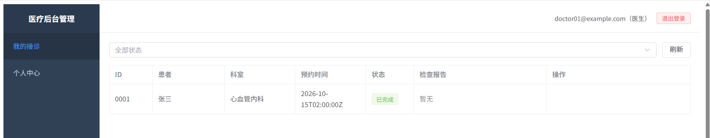
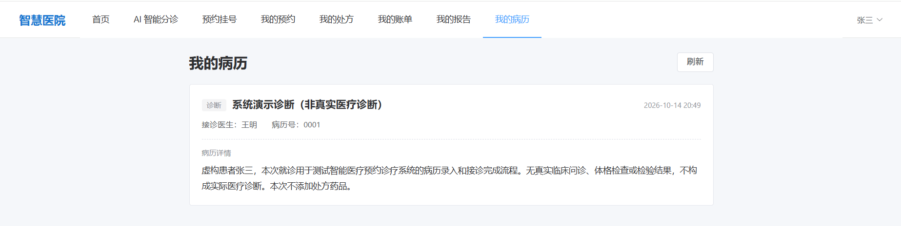
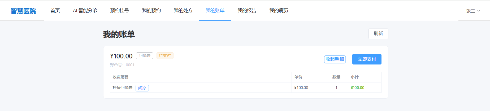

# 智能医疗预约诊疗系统

基于 **FastAPI + Vue 3 + PostgreSQL + Redis + Celery** 的前后端分离医疗业务演示系统，围绕患者预约、医生接诊、电子病历和费用账单等流程构建，并集成基于 **DeepSeek、自定义工作流编排与 RAG** 的 AI 辅助能力。

> 本项目使用虚构演示数据，用于开发学习、技术交流与求职展示；不接入真实患者或医保系统。AI 内容仅作辅助参考，不能替代专业医疗诊断，不可直接用于医疗机构生产环境。

## 系统架构

```text
患者端 medical-client (Vue 3 + TypeScript + Vite)
                  │
                  ├────── HTTP API ──────┐
                  │                      │
管理后台 medical-admin (Vue 3 + TypeScript + Vite)
                                         │
                              FastAPI 后端 Backend
                                  │         │
                              API / Service / ORM
                                  │         │
                          PostgreSQL     Redis
                           + pgvector    (会话 / Celery Broker)
                                  │
                         RAG / LLM / Celery 任务
```

两个前端分别面向患者及医疗后台角色，业务接口由同一套 FastAPI 服务提供。后端按 API、Service 与 SQLAlchemy ORM 模型组织代码；部分 AI 任务通过 Celery 异步处理。Celery 的 Broker 和结果存储使用 Redis。

## 核心功能

| 模块 | 功能概要 |
| --- | --- |
| 患者预约 | 浏览医生与科室、创建/查询/取消预约；服务端验证医生归属科室 |
| 医生接诊 | 处理预约、录入电子病历、更新接诊状态 |
| 病历与费用 | 患者查询病历、账单和收费明细；支持支付订单及状态查询相关流程 |
| 后台管理 | 科室、医生、药品、报告、账单等管理界面，以及按角色组织的业务操作 |
| 智能分诊 | Redis 多轮会话、RAG 检索、本院科室匹配、大模型生成和流式回复 |
| 检查报告与 AI 辅助 | 报告查询、报告解读相关服务及 Celery 任务代码 |

**本地已验证的业务子链路：** 患者预约 → 医生录入病历并完成接诊 → 自动生成问诊费账单及明细 → 患者查看预约、病历和账单；已结合浏览器页面和 PostgreSQL 数据核对。上述验证不涵盖完整支付回调、检查报告解读、发药流程或外部大模型调用。

## 系统演示截图

以下为**本地独立演示环境**的真实页面截图，使用虚构的患者、医生及业务数据。截图展示的范围为预约、接诊、电子病历和账单明细，不代表完整支付流程或外部 AI 服务已通过端到端验证。

### 1. 患者端：预约记录


### 2. 医生端：接诊管理



> 医生端列表显示 UTC 时间（`Z`），患者端显示本地时间；截图中的 `02:00Z` 对应北京时间 `10:00`。

### 3. 患者端：电子病历



### 4. 患者端：费用账单



> 演示账单处于**待支付**状态，本次验证范围是账单自动生成、明细持久化及患者侧查询，不包含实际收款或支付回调成功。

## 技术栈

- **后端：** Python 3.12、FastAPI、Pydantic、SQLAlchemy（异步）、Alembic
- **前端：** Vue 3、TypeScript、Vite、Vue Router、Element Plus
- **存储与异步：** PostgreSQL、pgvector、Redis、Celery
- **AI/RAG：** DeepSeek、DashScope Embedding、PostgreSQL 全文检索、pgvector 向量检索、RRF 排序融合
- **部署：** Docker / Docker Compose；支持独立启动前端开发服务

## 项目目录

```text
smart-medical-appointment-system/
├── Backend/
│   ├── app/
│   │   ├── api/          # 患者端和后台 API
│   │   ├── services/     # 业务逻辑与公共 AI/RAG 服务
│   │   ├── models/       # SQLAlchemy ORM 模型
│   │   ├── schemas/      # 请求与响应数据结构
│   │   ├── core/         # 配置与基础设施
│   │   └── schedule/     # Celery 任务相关模块
│   ├── migrations/       # Alembic 数据库迁移
│   ├── scripts/          # 演示账号、药品初始化和 Agent 评测脚本
│   └── README.md         # 后端专项说明
├── medical-admin/        # 医疗管理后台
├── medical-client/       # 患者端
├── docs/screenshots/    # 虚构数据的实际运行截图
└── README.md             # 本文件
```

## 本地运行参考

**环境：** Python 3.12、Docker Desktop / Docker Compose V2、Node.js 与 npm。以下仅为开发环境启动参考；首次运行需要按本机网络、数据库及环境变量完成配置。

1. 在 `Backend/.env.example` 的基础上准备自己的私有 `.env`，设置 PostgreSQL、Redis、JWT 等必要参数；按 Docker Compose 文件要求设置运行目录 `RUNTIME_DIR`。**切勿将真实 `.env`、密钥、日志、数据库文件提交到 GitHub。**
2. 在 `Backend` 目录中使用 `docker-compose.yml` 和 `docker-compose.dev.yml` 组合启动 `postgres`、`redis`、`app`，并完成 Alembic 数据库迁移。初次演示账号及基础数据可通过 `scripts/` 下的初始化脚本配置；注意避免对现有数据库重复初始化。
3. 分别进入 `medical-admin` 与 `medical-client`，执行 `npm ci` 安装依赖。在前端开发环境中将 `BACKEND_PROXY_TARGET` 指向本机 FastAPI 服务，再执行 `npm run dev`。

已验证的独立本机演示环境使用后端端口 **8001**、管理后台 **3000**、患者前端 **3001**。开发环境健康检查示例：`http://127.0.0.1:8001/api/v1/config/health`。实际端口由本机配置决定。

> Celery Worker、外部模型 API 等扩展能力需要额外的运行配置，不能仅凭 FastAPI 健康检查通过推断相关任务正常执行。

## 工程设计与验证边界

- **业务一致性：** 预约 Service 在写入前验证医生存在、科室存在以及医生与科室的关联关系。
- **数据隔离：** 患者侧的病历、账单、报告等查询按患者身份限定数据范围。
- **检索方案：** 使用 pgvector 向量检索与 PostgreSQL 全文检索，按 RRF 融合排序；Rerank 保留为可选能力，不视为默认启用链路。
- **运行验证：** 本地完成预约、医生接诊、病历、自动问诊费用及患者查询的子链路验证；AI、异步报告解读和完整支付业务尚未作为本次端到端验证结论。
- **适用边界：** 正式医疗场景还需要更严格的临床验证、隐私保护、访问审计、数据安全和合规措施。
